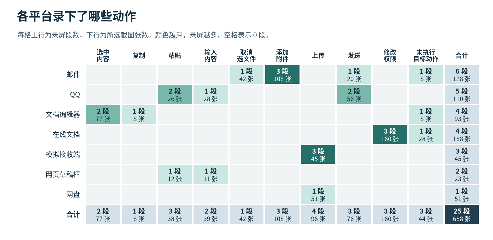
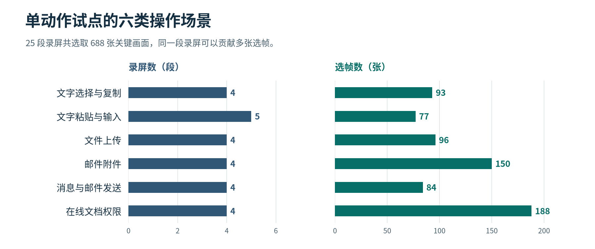
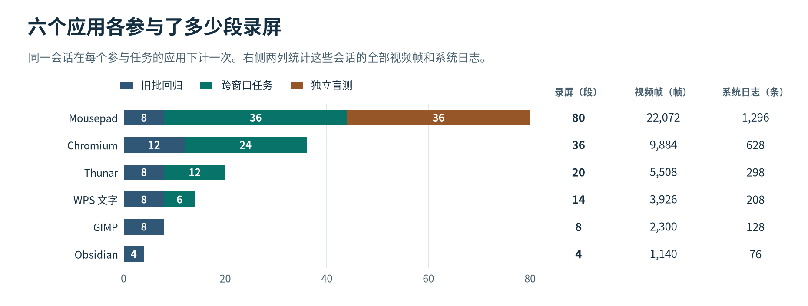
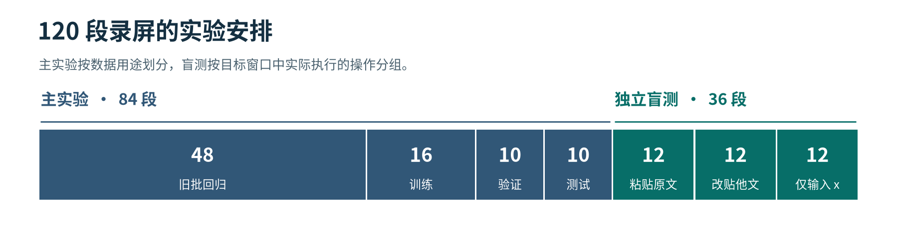
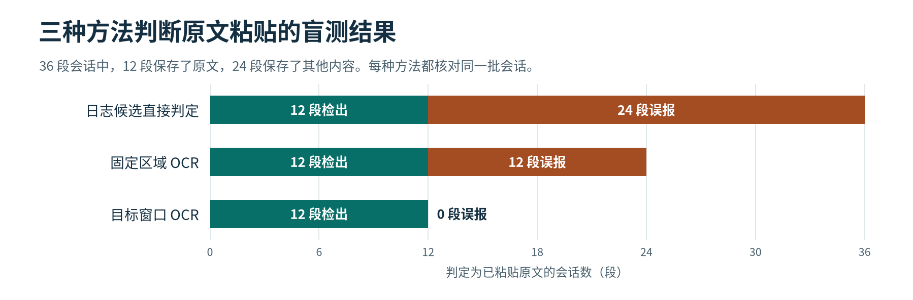

# ScreenGuard 实验数据

本仓库收录桌面操作的屏幕画面与日志，用于核对复制粘贴、文件上传和权限修改等动作是否实际发生。

## datav1 · 单动作试点

7 类应用或平台共录制 25 段，选取 688 张截图。下图用录制计划确定平台，用实验记录中的实际主要动作（`actual_action`）归类。每段只计一次，其选帧归入同一格。文字标注仍待审核。[录制计划](datav1/recording-plan.csv) · [实际动作记录](datav1/experiment-result.csv) · [选帧索引](datav1/frames.csv) · [数据说明](datav1/README.md)

QQ 的 2 段发送分别是发文字和发文件。4 段上传中，模拟接收端接受 2 段、拒绝 1 段，网盘完成 1 段。网页草稿框的两段分别是原录屏输入了其他内容，以及重试时粘贴了目标文字。

按六类实验场景查看录屏数与选帧数

## datav2 · 录屏与日志核对

120 段完整录屏共 33,532 帧，配有 1,853 条系统日志，以及逐段的 Agent 操作和时间同步记录。84 段主实验用日志查找涉及指定素材的会话，再用录屏核对操作，包括 48 段旧批回归和 36 段跨窗口任务。另有 36 段独立盲测，检验原文是否真正进入目标窗口。[会话索引](datav2/ScreenGuard_原视频与日志_120段/index.csv) · [逐段录像与日志](datav2/ScreenGuard_原视频与日志_120段/) · [文件说明](datav2/ScreenGuard_原视频与日志_120段/README.md)

### 应用与操作分布

按 Agent 实际操作的任务窗口与系统前台窗口日志核对应用。跨应用会话在每个参与应用下各计一次，因此下图各行的录屏、视频帧和日志数都有重叠。

| 应用 | 旧批回归中的操作 | 跨窗口任务中的操作 | 独立盲测中的操作 |
| --- | --- | --- | --- |
| Mousepad | 追加、替换、撤销编辑后保存，以及文档内复制粘贴，各 2 段 | 36 段均在目标窗口粘贴并保存，其中 30 段的复制源也是 Mousepad | 粘贴原文、改贴另一段文字、仅输入 `x`，各 12 段 |
| Chromium（本机收件箱） | 取消选文件、撤回暂存附件、提交附件，各 4 段 | 同样三种操作，各 8 段 | 0 段 |
| Thunar（文件管理器） | 确认改名、取消改名、跨目录复制、跨目录移动，各 2 段 | 保存后确认改名、取消改名，各 6 段 | 0 段 |
| WPS 文字 | 追加文本并保存、另存副本、导出 PDF、取消另存，各 2 段 | 从 WPS 复制原文到 Mousepad，共 6 段 | 0 段 |
| GIMP | 复制图像像素、复制后取消选区、从剪贴板新建图像、导出 PNG，各 2 段 | 0 段 | 0 段 |
| Obsidian | 追加文本并保存、撤销编辑并保存，各 2 段 | 0 段 | 0 段 |

36 段跨窗口任务均先复制文本并在 Mousepad 保存。随后有 12 段在 Thunar 处理改名，24 段在 Chromium 处理附件。

查看主实验的训练、验证、测试划分及盲测分组

### 独立盲测结果

盲测在 Mousepad 中用保存后的目标文件核实原文是否粘贴成功。三种操作各有 6 段目标窗口在左、6 段在右。三种方法都检出了 12 段原文粘贴。固定区域文字识别（OCR）的 12 次误报均发生在目标窗口位于左侧、右侧仍显示源文档时。按目标窗口读取文字后，24 段对照中的误报降为 0 次。[逐段结果](datav2/ScreenGuard_实录盲测逐段结果.csv) · [结项报告](datav2/ScreenGuard_实录盲测与结项报告.md)

